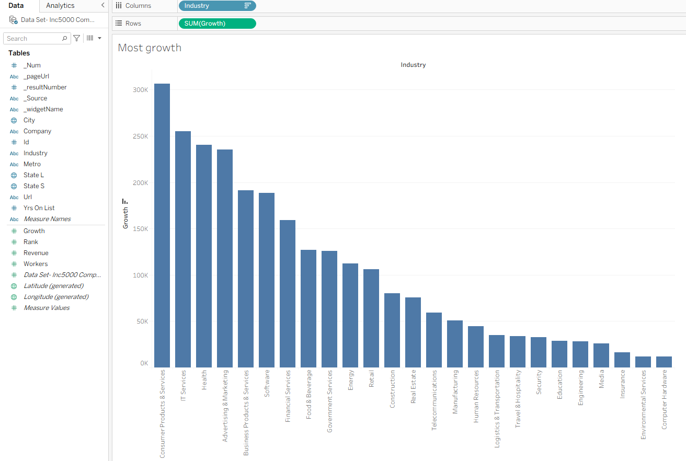
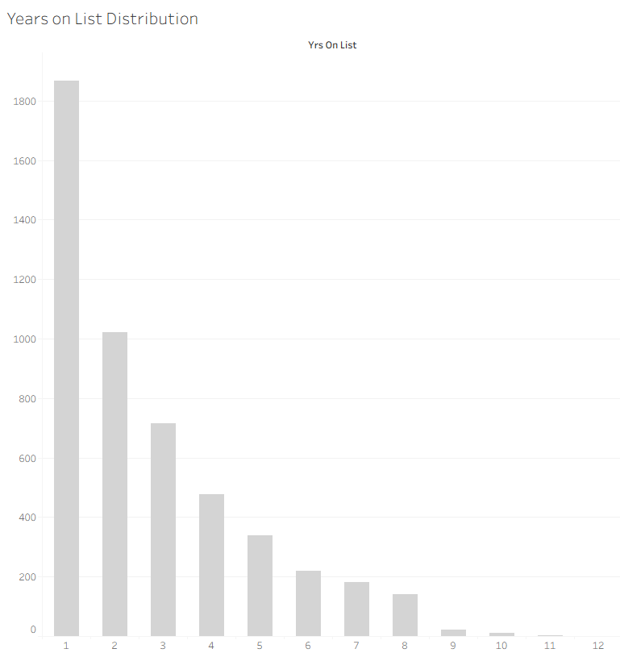
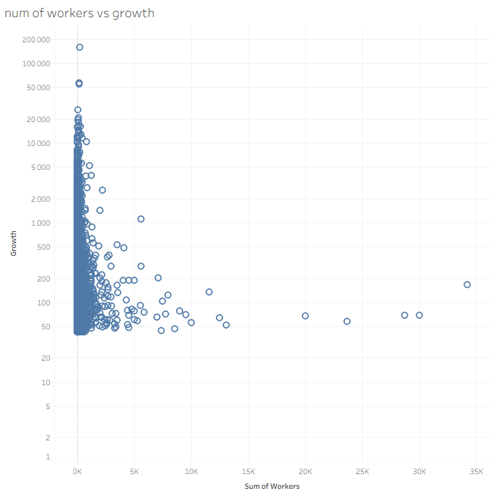
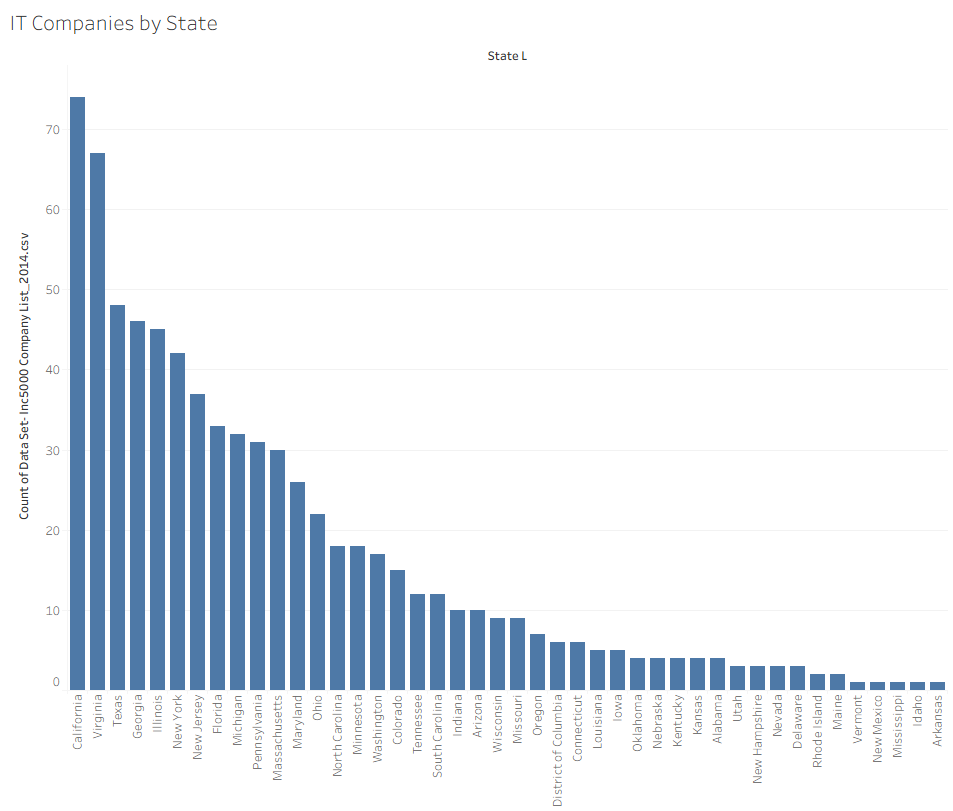
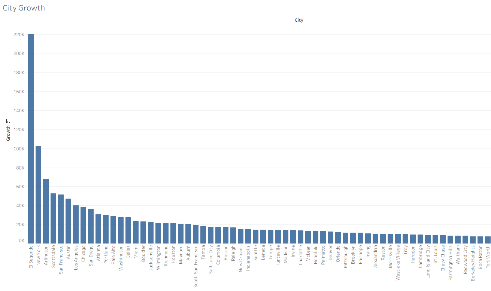

<h1>
   
</h1>

This project uses the Inc. 5000 company dataset to explore company growth, industry trends, workforce size, and geographic distribution across the United States. Tableau was used to create visualisations examining growth by industry, years on the list, employee count versus growth, and company distribution across states and cities.

<h1></h1>

&#8287;&#8287;• `Data Set- Inc5000 Company List_2014.csv` — contains company information used to create the Tableau visualisations.

&#8287;&#8287;• `Company-Growth.twbx` — packaged Tableau workbook with visualisations and data.

<h1></h1>

&#8287;&#8287;**Data visualisation and exploration using Tableau:**

&#8287;&#8287;&#8287;&#8287;• Company growth by industry  
&#8287;&#8287;&#8287;&#8287;• Distribution of companies by years on the Inc. 5000 list  
&#8287;&#8287;&#8287;&#8287;• Employee count vs. company growth scatter plot  
&#8287;&#8287;&#8287;&#8287;• IT companies by US state  
&#8287;&#8287;&#8287;&#8287;• Company growth across US cities  

&#8287;&#8287;**Exploration of business growth patterns and geographic distributions through charts.**

<h1></h1>

1. Download `Company-Growth.twbx` from this repository.
2. Open the packaged workbook using Tableau Desktop or compatible Tableau software.
3. Navigate through the worksheets to view the visualisations.

<h1></h1>

&#8287;&#8287;• Tableau Desktop or compatible Tableau software  
&#8287;&#8287;• Inc. 5000 company dataset  

<h1></h1>

<strong>Company Growth by Industry</strong>

<h1></h1>

<strong>Years on the List Distribution</strong>

<h1></h1>

<strong>Employee Count vs. Company Growth</strong>

<h1></h1>

<strong>IT Companies by State</strong>

<h1></h1>

<strong>City Growth in the USA</strong>

<h1></h1>
